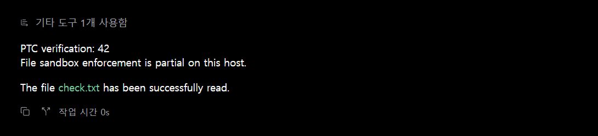
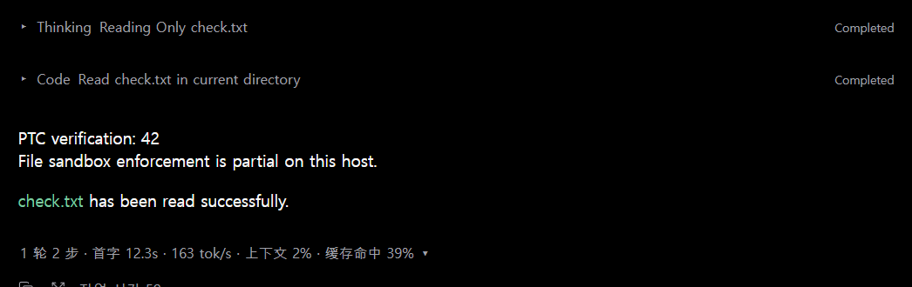
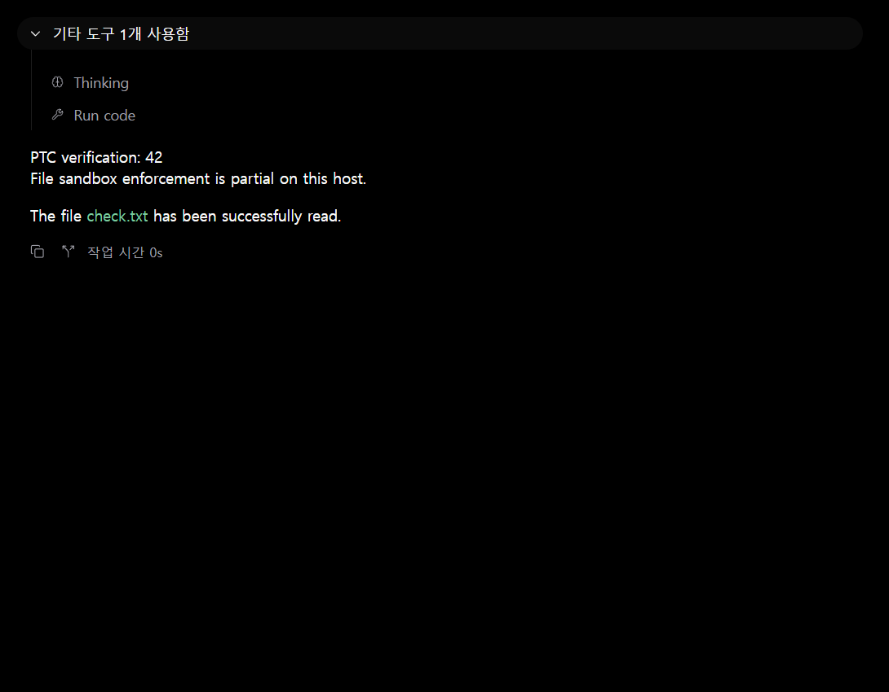
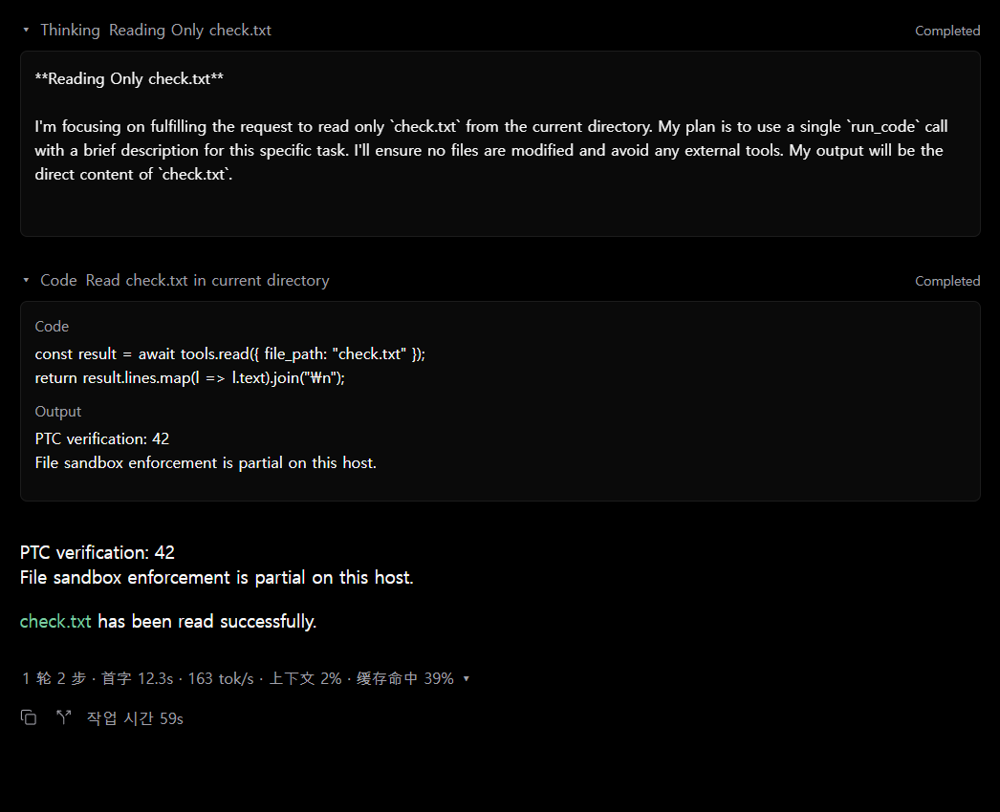

# DSH progress in Paseo

The provider publishes its returned reasoning and root `run_code` calls as
plugin-owned timeline rows. They remain visible in Paseo's collapsed/Overview
presentation, where generic reasoning and unknown tools otherwise join the
host's tool-count summary. There is no additional group header.

Each reasoning step has one initially collapsed row. During streaming the
preview follows DSH's latest completed paragraph heading; after settlement it
uses the first line. Markdown bold markers are removed from the preview only.
No summary is generated and no additional reasoning is requested. If DSH sends
no reasoning, no reasoning row is invented.

Each root `run_code` call has one row showing its model-authored `description`
(fallback: `Run code`) and status. Internal file/shell dispatches are not separate
rows. Todo, question, plan and subagent semantics retain their native cards.

Both previews occupy one visual line and ellipsize to the available width;
there is no fixed character limit for the preview. Status labels are `Running`,
`Completed`, `Failed` and `Canceled`. Details mount only when expanded, inside a
scroll area at most 360 logical pixels high. A detail block initially displays
up to 50,000 characters, with a `Show full text` action to reveal the remainder.
The stored reasoning, code and output are not truncated.

## Identity and settlement

| Content | ID | Plugin kind |
| --- | --- | --- |
| Returned reasoning | `reasoning:<turn>:<step>` | `dsh-reasoning` |
| Root program | `tool:<callId>` | `dsh-run-code` |

Live updates, authoritative assistant snapshots and replay use the same
factories and IDs. Repeated call observations preserve an already settled row.
Turn completion, interruption, runtime exit and session close settle pending
rows. A late aborted tool result cannot overwrite a live cancellation with a
failure. An abandoned stream stays pending until the turn outcome or a retry,
rather than reporting a successful completion.

## Host grouping and scope

Only these DSH-owned rows change presentation. Ordinary assistant messages and
native tool items continue through Paseo's existing renderers and grouping.
The client registers two renderers, not a global reasoning/tool transformer,
so it does not rewrite other providers' items. The existing statistics row is
unchanged. No PTC execution, bridge protocol, dependency, model configuration,
token budget or model-call behavior changes.

The Windows desktop validation used Paseo 0.15.4 without better-paseo. That
third-party plugin was not tested; no compatibility claim is made for its
layout or grouping overrides.

## Visual evidence

These are actual Paseo 0.15.4 window captures, limited to the test transcript
region to omit unrelated projects, accounts and the composer. They are not
mockups. Both examples read a disposable `check.txt` containing
`PTC verification: 42`.

The before captures replay a recorded DSH turn through the unmodified upstream
`TimelineBuilder`. The after captures are a separate live Gemini/PTC turn with
the candidate display code; model wording and timing therefore differ. On
Windows the live test also needs the independent launcher fix from #10, which
is not included in this PR. A notice about partial host sandbox enforcement is
already part of DSH's tool output and is simply reproduced here.

| State | Before | After |
| --- | --- | --- |
| Overview / details collapsed |  |  |
| Opened disclosures |  |  |

Opening the native group reveals the generic `Thinking` and `Run code` rows.
With the candidate, the reasoning preview and model-authored description are
already visible before opening either disclosure.

## Checks

Run `npm run typecheck` and `npm run test:timeline` inside `paseo-plugin`.
The session tests use a real stdio child with a deterministic protocol fixture;
only its executable selection is intercepted. They do not require DSH, model
credentials, or the separate Windows launcher fix. Tests cover stable live,
snapshot and replay identity; native item preservation; status settlement;
internal-dispatch filtering; missing descriptions; and DSH preview boundaries.
