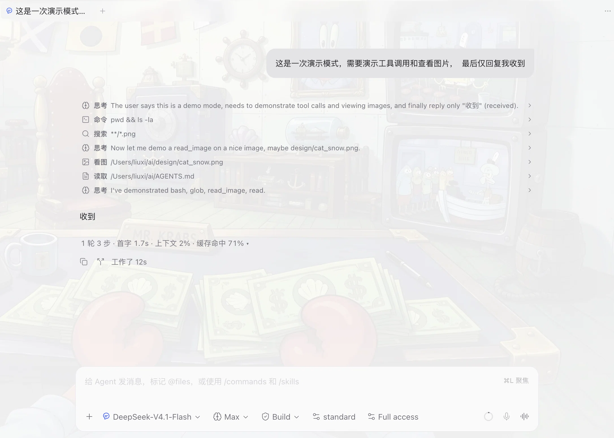

dsh-paseo adds a native provider to Paseo for DeepSeek Harness (`dsh`), so a Paseo agent runs as a DSH session instead of an ACP client. The conversation stays in Paseo's normal agent view. The plugin also adds one DSH Plugins page in Paseo's sidebar for managing the bundles in the profile it drives. It is a community plugin, not an official DeepSeek or Paseo product.

Each Paseo agent session starts one `dsh --profile paseo` child process on the daemon machine and talks to it over a local stdio bridge. The process runs as your operating system user with the daemon's environment, so the credentials and permission policy are the ones DSH already uses; the plugin adds no sandbox of its own. Model and reasoning-effort choices come from the catalog DSH reports for the profile, so they follow your DSH configuration.

DeepSeek Harness must be installed and logged in on the daemon machine, with `dsh` on the daemon's `PATH` or set through the provider command override. The plugin needs Paseo 0.16 or newer and Node.js 22 or newer on the daemon, and DSH 0.2.2-rc.1 is the tested line. On first use it provisions `~/.dsh/profiles/paseo`, and it never overwrites an existing profile file, so local edits to `cordis.patch.yml` survive reloads.

Composer features are passed to DSH rather than emulated. Attached images are admitted into DSH's attachment store, `/` commands and user-invocable skills come from DSH's registry, and steering, plan mode, question cards and permission prompts render as normal Paseo items. The session menu can switch the agent preset and permission mode when the profile declares them, the composer shows the context window and current occupancy that DSH reports, and each answer carries a small line with its first-token latency and output speed. Sessions persist by DSH session id, so a reopened agent resumes its context, and Paseo can list and import existing DSH sessions; an imported session replays its messages into the timeline. The DSH Plugins page lists the profile's bundles, switches them on or off, installs registry packages that declare `dsh.bundle`, removes them, and checks for updates. Package operations go through `dsh plugin`; changes apply to new sessions. Bundles that ship a DSH web client UI are marked, because Paseo does not host DSH's client runtime.

Images flow one way. The model receives attached images, but Paseo's transcript renders an image only from an `https://` Markdown URL, so a picture produced on the daemon has to be published to a URL first. Local paths, `file://` URIs and base64 data URLs do not display.

Every label the plugin draws follows the Paseo app language by default: timeline rows, the thinking row, the detail sheet, the per-turn stats line and the display settings screen ship with English and Simplified Chinese catalogs, and are worded from the app language rather than from the provider. Changing Settings → General → Language re-words them without restarting the plugin. The plugin's own display settings can also force English or Simplified Chinese for the screens it draws; host-owned labels such as the settings entry keep the app language. Known limits: there is one `dsh` process per session, so each agent costs a process. Reloading the plugin or restarting the daemon ends a running turn, and the session has to be resumed. The provider id is `deepseek-harness-native`, which keeps it separate from an ACP `deepseek-harness` provider when both are installed. Windows and native iOS and Android clients are untested.
