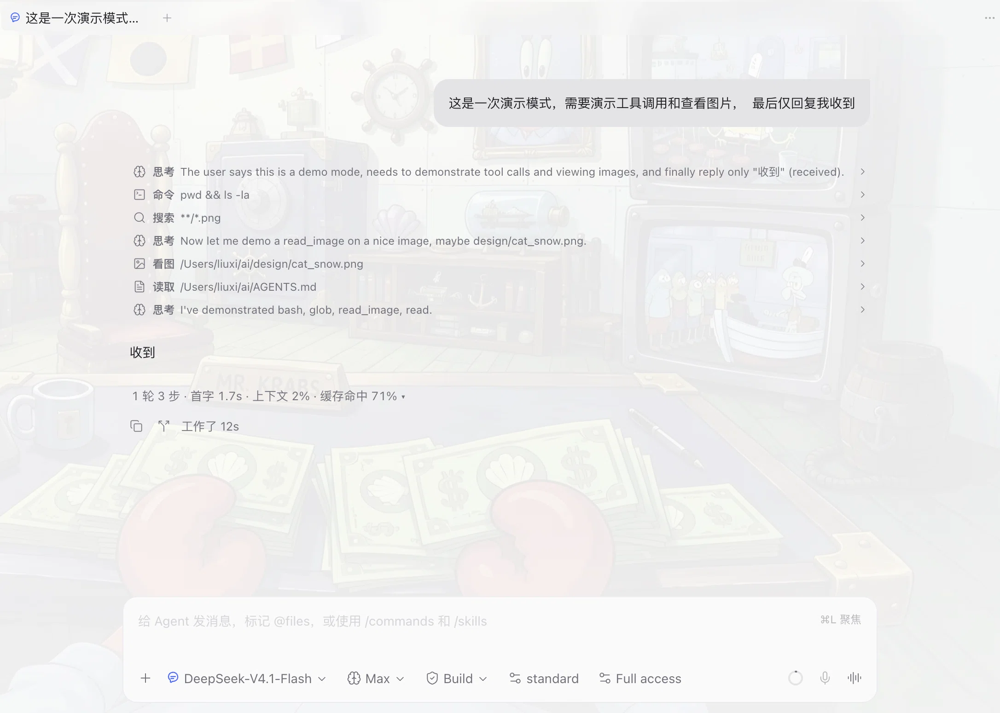

dsh-paseo 给 Paseo 加一个 DeepSeek Harness（`dsh`）原生 provider，让 Paseo 的 agent 以 DSH 会话的方式运行，而不是当一个 ACP 客户端。对话仍在 Paseo 平时的 agent 视图里，插件还在 Paseo 侧边栏加一个 DSH Plugins 页面，用来管理它所驱动的 profile 里的 bundle。它是社区插件，不是 DeepSeek 或 Paseo 的官方产品。

每个 Paseo agent 会话都会在 daemon 所在机器上起一个 `dsh --profile paseo` 子进程，并通过本地 stdio 桥与它通信。进程以你的操作系统用户身份、用 daemon 的环境运行，所以凭据和权限策略就是 DSH 本来用的那一套；插件自己不加沙箱。模型和思考档位的选项来自 DSH 为该 profile 报告的能力目录，因此跟随你的 DSH 配置。

daemon 机器上必须已安装并登录 DeepSeek Harness，`dsh` 要在 daemon 的 `PATH` 上，或通过 provider 的命令覆盖指定。插件需要 Paseo 0.16 或更新版本、daemon 上 Node.js 22 或更新版本，实测基准是 DSH 0.2.2-rc.1。首次使用时它会准备 `~/.dsh/profiles/paseo`；已存在的 profile 文件从不覆盖，所以你手改的 `cordis.patch.yml` 能活过重载。

输入框里的功能是交给 DSH 执行的，不是仿造的。附加图片会进 DSH 的附件库；`/` 命令与用户可调用的 skill 来自 DSH 的注册表；插话、计划模式、提问卡与权限确认都按 Paseo 正常的条目渲染。会话菜单能在 profile 声明了的时候切换 agent preset 与权限模式，输入框会显示 DSH 报告的上下文窗口与当前占用，每个回答下面还有一行首字延迟与输出速度。会话按 DSH 会话 id 持久化，重开会话会接着用原来的上下文，Paseo 也能列出并导入已有的 DSH 会话；导入的会话会把消息回放进时间线。DSH Plugins 页面列出 profile 里的 bundle，可以启停、安装声明了 `dsh.bundle` 的 registry 包、卸载并检查更新。包操作走 `dsh plugin`，改动对新会话生效。带 DSH Web 客户端界面的 bundle 会被标注，因为 Paseo 不承载 DSH 的客户端运行时。

图片是单向的。模型能收到你附上的图片，但 Paseo 的对话记录只渲染来自 `https://` Markdown 地址的图片，所以在 daemon 上生成的图片必须先发布成 URL。本地路径、`file://` URI 和 base64 data URL 都显示不出来。

插件画出的每一个标签都跟随 Paseo 的应用语言：时间线行、思考行、详情抽屉、每回合统计行和时间线样式页都自带英文与简体中文两套文案，用词看应用语言而不是看 provider。在 设置 → 通用 → 语言 里切换，不用重启插件就会换词。

已知限制：每个会话一个 `dsh` 进程，所以每个 agent 都要花一个进程。重载插件或重启 daemon 会结束正在跑的回合，会话需要重新恢复。provider id 是 `deepseek-harness-native`，这样同时装了 ACP 的 `deepseek-harness` provider 时两者不会冲突。Windows 以及原生 iOS、Android 客户端未测试。
